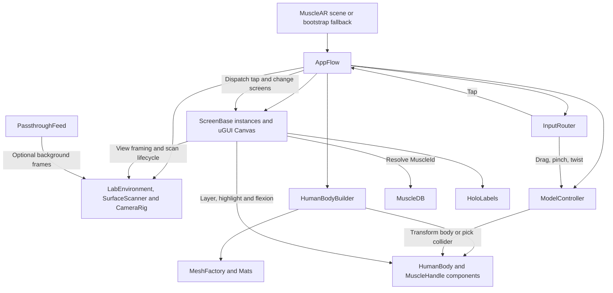
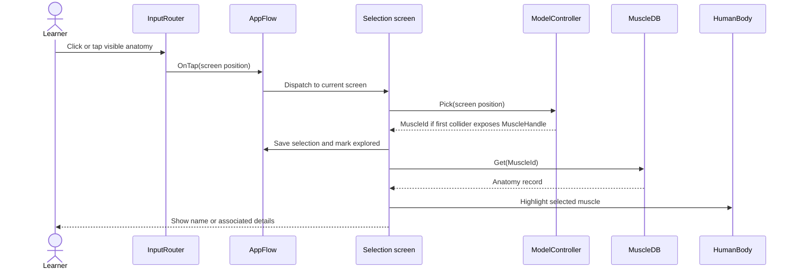

# MuscleAR | Academic Project Report

## 1. Cover Page

| Field | Details |
| --- | --- |
| **Project title** | MuscleAR — Interactive 3D Anatomy Lab |
| **Submission type** | Software engineering project report |
| **Student name(s)** | [Full name(s)] |
| **Enrollment number(s)** | [Student ID(s)] |
| **Programme and department** | [Programme and department] |
| **Institution** | [University or college] |
| **Supervisor** | [Name and designation] |
| **Academic year** | [Academic year] |
| **Submission date** | [Date] |
| **Source baseline** | Git commit `7767561` |

## 2. Abstract

MuscleAR is a Unity prototype for exploring gross muscle anatomy through an interactive virtual tabletop laboratory. It generates the lab, body geometry, materials, and 16-screen interface from C# at runtime. The learning flow combines model placement and manipulation, selectable muscle regions, anatomical descriptions, four layer views, a split-view inspection screen, an elbow-flexion demonstration, and a five-question recognition quiz. An optional webcam feed changes the visual background while a timed scan and a fixed virtual tabletop determine placement. This report describes the software architecture, implementation, and test design. Static checks verified the scene configuration, screen registration, and the correspondence between muscle identifiers and catalogue records. The local Unity launch stopped at license validation before Play Mode, so runtime behavior, mobile compatibility, and learning outcomes remain unverified.

## 3. Introduction

Learning a muscle involves relating its name and position to adjacent structures and to the movement it helps produce. MuscleAR addresses this task through a single environment in which a learner can change perspective, compare anatomical layers, and inspect a structure before answering recognition questions. The app is a guided teaching prototype for gross anatomy. Geometry and text are authored directly in the project, with simplified representations of anatomical structures.

The checked-in project specifies Unity `6000.5.5f1`, C#, the Built-in Render Pipeline, and Unity UI. The main scene contains the application controller, which constructs the rest of the experience on startup.

## 4. Problem Statement

A static diagram fixes the viewing angle and often presents structural labels separately from their physical actions. Learners must mentally integrate multiple images to infer the relationship between a muscle, its attachments, and its role. The engineering problem is to build a cohesive, interactive demonstration that links these elements and supports self-paced recognition practice within one Unity application.

## 5. Objectives

1. Generate a layered 3D human model and a virtual lab from version-controlled source.
2. Provide a guided tabletop placement workflow with mouse, keyboard, and touch input paths.
3. Resolve visible muscle selections to a shared catalogue with location, origin, insertion, and function.
4. Support whole-body and close-up comparison, as well as a manual or automatic elbow-flexion demonstration.
5. Present a five-question recognition quiz with per-answer feedback and a final score.
6. Keep first-time setup reproducible through a pinned editor version and a committed package manifest and lockfile.

## 6. Scope of the Project

| In the current source | Beyond the current implementation |
| --- | --- |
| Virtual tabletop scan with progress, feature points, grid, and outline | Camera-based plane detection, spatial tracking, world anchors, and real-world scale calibration |
| One procedural body, four layer views, and 31 muscle or muscle-group records | Anatomical variants, systematic anatomical validation, and more detailed coverage |
| One biceps-focused elbow-flexion demonstration | Multi-joint muscle simulation, biomechanics, force estimation, and motion capture |
| In-session exploration and recognition quiz | Saved learner profiles, curriculum integration, and longitudinal analytics |
| Local Editor workflow and optional device camera path | Verified mobile builds, device compatibility matrix, and classroom evaluation |

## 7. Literature Review / Existing System

Anatomy textbooks organize muscle study around structure, attachment, action, and the relationship between muscles and nearby bones. OpenStax distinguishes origins and insertions and describes how skeletal muscles produce and oppose motion. MuscleAR uses these concepts to organize its on-screen fields and the elbow demonstration [1].

A fixed illustration can provide a stable reference view. An interactive 3D model gives the learner additional viewpoints and can display several layers of the same body without switching to a different illustration. The prototype applies this design rationale. The project has no comparative study of diagrams and interactive instruction, so the relative effect on comprehension remains unknown.

Unity’s AR Foundation exposes detected environmental planes through a compatible device provider [6]. MuscleAR uses its own time-based scan sequence against a fixed tabletop. This limits spatial fidelity and keeps the lab workflow available without an AR-capable device. The webcam API supplies image frames for the optional background [5].

## 8. Proposed System

The working design has four learner-facing stages. Entry screens introduce the lab and select a mode. Placement screens simulate detecting a table and let the learner adjust and confirm the model. Exploration screens support gestures, labels, layer selection, close-up information, and a motion example. A summary and quiz close the session.

AR Explorer and Learn lead through the same guided exploration route. Quiz mode also goes through the placement screens, then branches directly to the quiz when the learner advances from screen 06. The summary offers a separate entry point into the quiz and a return to additional muscle exploration.

## 9. System Requirements

| ID | Functional requirement | Main source |
| --- | --- | --- |
| FR-01 | Start the lab and present the 16 registered screens. | `AppFlow.cs` |
| FR-02 | Animate the virtual surface scan and enable its placement button when detection finishes. | `SurfaceScanner.cs`, `ScreensEntry.cs` |
| FR-03 | Allow model translation, rotation, and zoom in the applicable screen modes. | `InputRouter.cs`, `ModelController.cs` |
| FR-04 | Map a muscle pick to a highlighted body region and its catalogue record. | `ModelController.cs`, `HumanBody.cs`, `MuscleDB.cs` |
| FR-05 | Show four layer views, a two-camera detail screen, and elbow flexion. | `HumanBody.cs`, `CameraRig.cs`, `ScreensLearn.cs` |
| FR-06 | Generate five recognition questions, score responses, and offer a return to the summary. | `ScreensLearn.cs` |
| FR-07 | Offer an optional camera background when a device is available. | `PassthroughFeed.cs`, `AppFlow.cs` |
| FR-08 | Record distinct explored muscle IDs within the current session. | `AppFlow.cs`, `ScreensLearn.cs` |

The baseline workflow is intended to work locally with the virtual lab background and no application backend. The desktop interface scales around a 390 × 844 reference viewport. Installation and rendering requirements follow the exact Unity editor version. The project does not define performance or accessibility acceptance thresholds.

## 10. Software and Hardware Requirements

| Component | Requirement or dependency |
| --- | --- |
| Unity editor | Unity 6.5, version `6000.5.5f1`, revision `d16e074b49fd` [2] |
| Unity project files | `Assets/` with Unity metadata, `Packages/`, and `ProjectSettings/` |
| Language and rendering | C# and Unity Built-in Render Pipeline. Standard and sprite shaders are located at runtime. |
| UI and input | `com.unity.ugui` `2.5.0`, `EventSystem`, and legacy `UnityEngine.Input` [3] |
| Other manifest entries | `com.unity.multiplayer.center` `1.0.1` and built-in Unity modules at `1.0.0`. Anatomy, interaction, and capture paths use engine capabilities such as physics, UI, screenshot capture, and image conversion. The source contains no multiplayer session logic. |
| Development machine | A desktop computer capable of running the pinned Unity editor with a working graphics device and an active Unity Editor license. No project-specific CPU, GPU, or memory minimum was benchmarked. |
| Interaction hardware | Mouse and keyboard for the Editor. Touch paths require a compatible touch-enabled player environment for verification. |
| Optional camera | A camera recognized by Unity and available to the app. The virtual background supports the core workflow without camera hardware. |
| Mobile validation | A target-specific Unity build module and physical test device would be needed for build and touch/camera verification. |

## 11. System Architecture



`AppFlow` owns the screen registry, current index, mode, selected muscle, and explored set. A transition exits and fades the previous screen, clears shared highlights and callouts, enters the destination screen, and updates the storyboard sidebar. Screens set the desired camera framing, model mode, visible layers, and callouts through references created during initialization.

`Assets/Scenes/MuscleAR.unity` is the only enabled scene in the build list. It serializes a root object with `AppFlow`. The existing scene snapshot in `Assets/_Recovery/` is tracked outside that list. The default application startup path uses the main scene. If a scene loads without the controller, `AppFlow.Boot` can create it at runtime.

## 12. Methodology

The source exhibits a code-first approach. A small serialized scene invokes runtime factories to construct the environment, anatomy, and interface. The anatomy builder defines body landmarks and body-part paths, uses geometry helpers to turn these into meshes, and registers selectable regions under shared identifiers. The user interface organizes those components into a guided sequence.

For this report, the repository review traced the build scene to `AppFlow`, mapped each screen to its source class, and followed representative execution paths for placement, selection, flexion, and quiz scoring. The package manifest and lockfile provided dependency information. Static checks addressed internal consistency, while the existing capture tour was attempted separately on a project copy.

## 13. Module Description

| Directory | Script | Role |
| --- | --- | --- |
| Core | `AppFlow.cs` | Starts the app, creates world and UI systems, updates viewport layout, manages navigation, and tracks in-session data. |
| Core | `QATour.cs` | Visits every registered screen and captures PNGs, including variants for selection and body layers. |
| Anatomy | `HumanBodyBuilder.cs` | Constructs meshes around anatomical landmarks, groups renderers, and registers anchors, handles, and pivots. |
| Anatomy | `MeshFactory.cs` | Interpolates paths and generates swept meshes, tubes, and primitive geometry with normals and UVs. |
| Anatomy | `Mats.cs` | Builds runtime materials and generates fibre, wood, and noise textures. |
| Anatomy | `HumanBody.cs` | Manages render groups, muscle selection and hint effects, body landmarks, and flexion pivots. |
| Anatomy | `MuscleDB.cs` | Maps each `MuscleId` to display name, Latin label, location, origin, insertion, function, and detail. |
| UI | `UIKit.cs` | Creates uGUI layout elements, labels, controls, and procedural sprites. |
| UI | `ScreenBase.cs` | Defines the screen lifecycle and reusable navigation, cards, labels, layouts, and model helpers. |
| UI | `ScreensEntry.cs` | Implements screens 01–08, covering entry, mode selection, scanning, placement, and gesture tutorials. |
| UI | `ScreensLearn.cs` | Implements screens 09–16, covering selection, details, layers, flexion, session summary, and quiz. |
| World | `LabEnvironment.cs` | Generates and lights the virtual lab and table, with normal and scan lighting looks. |
| World | `CameraRig.cs` | Manages framing, orbiting, split-view rendering, and the background camera. |
| World | `SurfaceScanner.cs` | Advances a timed virtual scan and animates grid, sweep, points, and the detected outline. |
| World | `ModelController.cs` | Applies tabletop translation, model yaw and scale, and camera-based muscle picking. |
| World | `InputRouter.cs` | Converts mouse and touch interactions into drag, pinch, twist, and tap events. |
| World | `HoloLabels.cs` | Manages world-space label text, connector lines, and anchors that follow the model. |
| World | `PassthroughFeed.cs` | Selects a camera, presents live frames on a `RawImage`, and adjusts image orientation and crop. |
| Editor | `ProjectSetup.cs` | Provides scene/open and portrait-view helpers, project setup, and the QA entry point. |
| Editor | `DevTools.cs` | Renders isolated body and layer captures through dedicated cameras into PNG files. |

## 14. Implementation Details

### 14.1 World generation and anatomy

The body builder defines control points and cross-sections along the torso and limbs. `MeshFactory` uses Catmull–Rom interpolation for sampled paths. It sweeps elliptical rings along paths, connects adjacent rings into triangles, and builds mesh surface data. The builder groups objects by anatomical role and makes a standing model. The controller applies a lying pose for the tabletop view.

`HumanBody.SetLayer` changes active render groups and materials. Skin shows the outer shell. Muscle shows muscle geometry with tendons. Tendon uses the same groups with subdued muscle colours and emissive tendons. Bone displays skeletal and organ groups under a translucent skin shell. Muscle heads or bilateral regions can share a single catalogue ID.

### 14.2 Scanning, placement, and gestures

`SurfaceScanner.Begin` resets state and starts the sweep. Frame time advances progress over approximately three seconds. At completion the detected flag becomes true and the outline appears. `DetectSurfaceScreen.Tick` polls that flag to activate **Place Anatomy**. Confirmation on the next screen sets the placed flag and advances the storyboard. Keyboard and sidebar shortcuts can jump past ordinary entry conditions.

`ModelController` applies a camera-relative drag in Move mode and yaw in Explore mode. Table offsets are limited to ±0.22 m in X and ±0.50 m in Z. Zoom clamps the scale to 0.45–1.90 relative to the base model. In mode None, world gesture callbacks do not transform the model. Single-pointer tracking checks whether the press begins over UI. The two-touch path and global keyboard shortcuts have separate handling.

`PassthroughFeed` attempts to choose a non-front-facing camera when available and otherwise uses the first listed camera. If the device list is empty, the virtual background remains active. When the feed starts, the camera rig changes the background composition while preserving the virtual placement coordinate system.

### 14.3 Selection and details



The main camera casts one Unity physics ray up to 20 world units [4]. The controller looks for a `MuscleHandle` on the hit collider or its parent hierarchy. A non-muscle collider in front of the selection target can prevent a selection. Details reuse the catalogue record when the learner continues. The split view uses a second camera for the close-up, with the main camera retaining a whole-body view.

### 14.4 Flexion and quiz

The motion screen highlights the biceps and maps a normalized slider value to 0–145°. `HumanBody.Flexion` clamps the angle and rotates registered elbow pivots around their local axes. Muscle material colour also changes with the angle. The screen automatically cycles the pose until the learner moves the slider, and resets flexion when the learner exits.

At quiz entry, the code shuffles a fixed muscle pool and selects five distinct targets. Each question combines the correct target with three distinct alternatives from that pool. The score increments on the first correct response per question. The feedback handler also counts the target as explored regardless of the chosen answer. After question five, the result screen shows the score out of five and routes back to the progress summary.

## 15. User Interface and Screenshots

The portrait interface uses a reference size of 390 × 844, layered gradients, cards, labels, and bottom actions. An editor storyboard panel provides direct access to all screens in a wide Game view. Screen transitions and camera framing provide continuity through a single scene. Use the virtual background for screenshots intended for publication.

| Figure placeholder | Screen | Capture instructions and suggested caption |
| --- | --- | --- |
| Fig. 1 · [Insert home screen] | 01 | Capture the initial orbiting lab and **Enter Anatomy Lab** button. Caption it “Entry screen over the virtual anatomy lab.” |
| Fig. 2 · [Insert virtual scan] | 04 | Wait for **Surface detected**. Include the detected outline and active **Place Anatomy** button. |
| Fig. 3 · [Insert layer comparison] | 11 | Capture Muscle and Bone views in the same framing. Label each panel with the selected layer. |
| Fig. 4 · [Insert detail screen] | 12 | Capture a named muscle with whole-body view, close-up, and visible attachment fields. |
| Fig. 5 · [Insert flexion endpoints] | 13 | Capture the flexion slider at 0° and 145°. Keep the readout and elbow visible in both frames. |
| Fig. 6 · [Insert quiz feedback] | 16 | Choose an answer and capture the selected muscle, answer choices, and feedback. |

## 16. Testing and Test Cases

### Static checks performed

| Check | Procedure | Observed result |
| --- | --- | --- |
| ST-01 · Scene registration | Read the build settings and compare the scene and script GUIDs with their `.meta` files. | The enabled scene and its serialized `AppFlow` reference resolved. |
| ST-02 · Screen sequence | Read the registered constructors in `AppFlow.BuildScreens` and compare their screen numbers. | The 16 registered screens map to the sequence 01–16. |
| ST-03 · Catalogue coverage | Compare the `MuscleId` enum with the IDs populated in `MuscleDB`. | All 31 identifiers have one catalogue entry each. |
| ST-04 · Dependencies | Parse `manifest.json` and `packages-lock.json` and compare all direct names and versions. | Direct dependencies match entries in the lockfile. |
| ST-05 · Repository exclusions | Probe generated paths with `git check-ignore` and inspect tracked source and project metadata paths. | Generated folders are excluded. The main scene, scripts, packages, settings, and their existing tracked metadata remain under version control. |

### Runtime and device test plan

Run the following cases in Play Mode unless a physical device is specified. Record the Unity version, host or device, observed result, and screenshots or log excerpts where relevant.

| ID | Test procedure | Expected result | Status |
| --- | --- | --- | --- |
| RT-01 | Open the main scene, press Play, and enter the lab. | Home loads and navigation reaches onboarding and mode selection. | Pending |
| RT-02 | Enter screen 04 and observe the on-screen placement button before and after the scan finishes. | The button begins disabled and becomes active when **Surface detected** appears. | Pending |
| RT-03 | Choose **Place Anatomy**, then **Place Here**, and try dragging beyond the tabletop limits. | Confirmation reaches screen 06. In Move mode, the offset stays within its X and Z clamp bounds. | Pending |
| RT-04 | Use drag, `Q` / `E`, and mouse scroll on screen 08. Repeat pinch and twist on a touch device. | Model yaw responds and its scale remains within 0.45–1.90. | Pending |
| RT-05 | On screen 09 select a clearly visible muscle, advance, and compare the label and educational fields with `MuscleDB`. Also try clicking the empty background. | A valid hit selects the matching muscle and shows its anatomy fields. A miss leaves the selection unchanged. | Pending |
| RT-06 | Switch all four layer controls on screen 11, advance to the detail screen, then leave it. | Layers change as specified. Split view is enabled for details and disabled when that screen exits. | Pending |
| RT-07 | Scrub flexion to both limits, resume auto mode, and leave screen 13. | Angle displays 0° to 145°, pivot movement resumes in auto mode, and exit restores 0°. | Pending |
| RT-08 | Pick Quiz on screen 03 and complete placement. Answer all five questions, including a wrong answer and a repeated click. | Advancing from screen 06 opens the quiz. Every question has four options, only the first response counts, and final score and **Done** navigation work. | Pending |
| RT-09 | Toggle the camera with an available webcam, with no listed camera, and with permission denied on a device. | Available camera frames should appear. With no listed camera, the virtual lab should remain. Record the permission-denied outcome because the app does not verify that frames started. | Pending |
| RT-10 | Use the wide storyboard view and portrait Game view. Toggle `F1` and verify several screen shortcuts. | The reference layout remains usable and the sidebar toggles. | Pending |
| RT-11 | Finish a quiz, leave its result state with the left arrow, then start another quiz and answer its first question. | The first **Next** should advance to question two. Check for an early return to the summary caused by the previous **Done** callback. | Pending |

### Screenshot tour attempt

From PowerShell, with an activated Editor installation, the existing test harness can be invoked as follows. Replace the executable path with the installed `6000.5.5f1` editor path and run from the project root. The tour finishes by exiting the Unity instance it started.

```powershell
& "C:\Path\To\Unity\Editor\Unity.exe" -batchmode -projectPath "$PWD" `
  -logFile "$env:TEMP\musclear-unity-qa.log" -executeMethod MuscleAR.EditorTools.ProjectSetup.RunQA -qatour
```

`QATour` enters the registered screens directly and captures their frames into `Shots/`. It invokes muscle selection on screen 09 and changes layers on screen 11 programmatically. The resulting images are evidence of rendering and screen transitions. They leave actual pointer input, quiz grading, and physical camera behavior for manual verification.

The first local Editor installation was missing its Package Manager executable. The retry used a second installation of the pinned version with Package Manager present. Unity then reported **No valid Unity Editor license found** and exited with code 198 before Play Mode. The tour produced no screenshots and the runtime cases remain pending.

## 17. Results and Discussion

Static inspection identified one enabled entry scene, 16 registered screens, four body layer states, and a 31-record catalogue shared by model interaction and lessons. Code paths connect model picks to anatomy cards, camera framing, and highlights through `MuscleId`. This design reduces duplicate content and lets the quiz reuse names and visual targets from the same model.

The fixed virtual stage makes the main workflow independent of environmental tracking. The trade-off is that camera images and placement coordinates have no spatial registration. The game interface displays a count of distinct explored muscles. The structures and progress displays use `12 + 2n` and `min(100, 70 + 4n)` for explored count `n`. They are illustrative values. Interface text asserting “100% ACCURATE” is decorative text in the source and has no validation basis in this review.

The runtime launch blocker means the review provides source-level evidence only. It supplies no frame-rate data, device compatibility conclusions, measured learning gains, or anatomical validation.

## 18. Limitations

- Plane detection, tracking, and anchors are absent. Webcam frames serve as the background and do not influence placement.
- `PassthroughFeed` sets its active state when playback starts, before checking for valid frames. Permission handling and device behavior remain open verification items.
- The single-ray picker is sensitive to occlusion and collider coverage. It returns the first collider hit and requires that collider’s hierarchy to contain a muscle handle.
- The model is stylized and motion is a pivot-driven elbow example. Coverage, geometry, and descriptions have not been reviewed against clinical reference material by an instructor.
- AR Explorer and Learn share the same guided path. Gesture and progress prompts are instructional, and developer navigation can bypass physical interaction.
- Exploration and scores exist in memory. The structure count and completion percentage are computed display values, and the project has no learner profiles.
- Quiz result handling replaces the **Next** listener with a **Done** listener. The code restores the original listener when **Done** is clicked. Leaving the result state through a global shortcut bypasses that restoration and can affect the next quiz attempt.
- The test tour is visual tooling. Interactive regression testing, device verification, and accessibility testing remain outstanding.

## 19. Future Scope

| Improvement | Evidence or acceptance criterion |
| --- | --- |
| Add AR Foundation integration | Place the model on detected planes and verify stable anchors across camera motion and tracking recovery on supported devices. |
| Validate anatomy and descriptions | Record instructor review of names, attachment descriptions, proportions, and layer presentation. |
| Advance the motion module | Add separately validated joint demonstrations and identify the modeled movement and range on screen. |
| Improve learning progression | Define measurable completion criteria and verify persistence across app restarts if local storage is added. |
| Improve accessibility | Verify text scaling, contrast, alternative input, and quiz feedback that conveys state without depending on colour alone. |
| Add runtime regression coverage | Exercise startup, scan gates, quiz scoring, retries, gesture bounds, and camera fallback with reproducible tests. |
| Evaluate learning outcomes | Define a study protocol and assess recognition and recall with consenting participants before making efficacy claims. |

## 20. Conclusion

MuscleAR brings model manipulation, muscle identification, anatomical layers, elbow flexion, and recognition questions into one Unity scene. Source inspection established how the procedural model and learning interface share identifiers, how navigation drives each lesson, and where the simulated tabletop constrains placement. A licensed Editor run and the listed manual cases are needed to establish runtime behavior. Anatomical and classroom evaluation remain separate from software verification.

## 21. References

1. OpenStax. *Anatomy and Physiology 2e*, Chapter 11, “The Muscular System.” [Chapter review](https://openstax.org/books/anatomy-and-physiology-2e/pages/11-chapter-review)
2. Unity Technologies. *Unity 6000.5.5f1 release notes*. [Unity release page](https://unity.com/releases/editor/whats-new/6000.5.5f1)
3. Unity Technologies. *Unity UI documentation*. [Unity UI package manual](https://docs.unity3d.com/Packages/com.unity.ugui@2.0/manual/index.html)
4. Unity Technologies. *Physics.Raycast*. [Unity 6.5 scripting reference](https://docs.unity3d.com/6000.5/Documentation/ScriptReference/Physics.Raycast.html)
5. Unity Technologies. *WebCamTexture*. [Unity 6.5 scripting reference](https://docs.unity3d.com/6000.5/Documentation/ScriptReference/WebCamTexture.html)
6. Unity Technologies. *AR Foundation 6.0 — Plane detection*. [AR Foundation manual](https://docs.unity3d.com/Packages/com.unity.xr.arfoundation@6.0/manual/features/plane-detection.html)
7. MuscleAR project source, baseline commit `7767561`. [Runtime controller](Assets/Scripts/Core/AppFlow.cs) · [Muscle catalogue](Assets/Scripts/Anatomy/MuscleDB.cs) · [Package manifest](Packages/manifest.json) · [Build scenes](ProjectSettings/EditorBuildSettings.asset)
