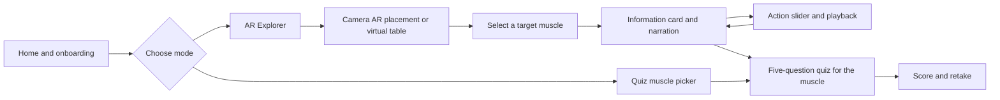
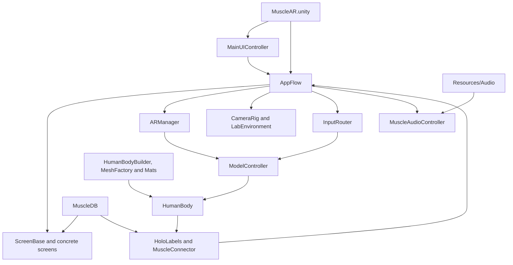
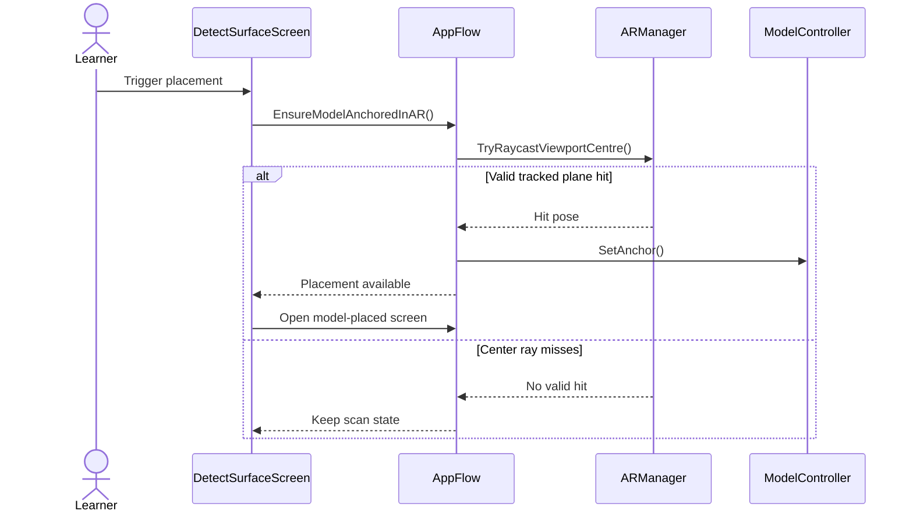

# MuscleAR — Academic Project Report

## 1. Cover Page

### MuscleAR
**A Unity application for exploring muscle anatomy through 3D visualization and mobile augmented reality**

| Field | Submission details |
| --- | --- |
| Submitted by | [Student name(s)] |
| Roll or registration number | [Roll number(s)] |
| Course or degree | [Programme and course code] |
| Department | [Department] |
| Institution | [Institution or university] |
| Supervisor | [Name and designation] |
| Academic year and submission date | [Academic year] · [Submission date] |

## 2. Abstract

MuscleAR is an educational prototype for studying six target muscles through a procedural 3D human model. It provides a virtual environment and an Android Camera AR mode that uses AR Foundation and the Google ARCore XR Plug-in. Learners can select a muscle, inspect its location, attachments and function, play recorded narration, and control a demonstration of the associated joint movement. A local question bank provides muscle-specific multiple-choice quizzes and immediate feedback. The implementation separates placement and manipulation of the model from deformation of its anatomy. A source review and the available editor checks document the software's behavior. Learning gains and reliability across physical devices remain subjects for evaluation.

**Keywords** — augmented reality, anatomy education, procedural geometry, Unity, ARCore, formative assessment.

## 3. Introduction

Studying the muscular system requires relating anatomical names and attachment points to three-dimensional positions and bodily movement. A static diagram communicates one view at a time. A manipulable representation lets learners inspect the same region from multiple angles and connect text to a visible structure. MuscleAR brings those activities into one local application.

The prototype provides two contexts for study. The virtual environment gives the model a consistent table and lighting setup. Camera AR uses the Android camera and pose tracking to place the same anatomy model on a real surface. Both modes reuse the same source of muscle data, model geometry and learning screens.

## 4. Problem Statement

A learner working with static materials must mentally combine different views and infer how an attachment or muscle position relates to motion. A software tool for introductory revision should let the learner identify a named structure, examine its position, see an associated movement, and attempt questions based on the material. The placement interface must also distinguish a valid real-world surface from a screen position where no surface has been detected.

## 5. Objectives

1. Render a selectable human model with six muscles used throughout exploration, audio, action demonstrations and quiz activities.
2. Provide real-world surface placement on compatible Android hardware and a virtual viewing environment for development and study.
3. Relate each muscle to its location, origin, insertion, function and representative movement.
4. Provide local formative assessment with immediate correctness feedback, explanations, scoring and retakes.
5. Preserve the user's model transform while changing the selected muscle or posing the anatomy during an action.

## 6. Scope of the Project

| Area | Current scope |
| --- | --- |
| Learner content | Biceps brachii, deltoid, pectoralis major, rectus abdominis, quadriceps femoris and gastrocnemius |
| Visual representation | Procedural geometry for the body with additional visual anatomy and four layer modes in the model API |
| Study workflow | Selection, information card, narration, action demonstration, session progress and muscle-specific quizzes |
| Viewing modes | Virtual Lab or Day environment and Android Camera AR |
| Persistence | In-memory exploration state and quiz attempts |
| Outside the implemented scope | A full anatomy atlas, clinical validation, a dedicated layer exploration interface, cloud accounts and an ARKit build |

## 7. Literature Review / Existing System

Printed atlases provide consistent labeled reference views. Desktop 3D tools add rotation and scale, and AR places the digital representation alongside the learner's surroundings. Each approach changes the kind of spatial interaction available, so the appropriate comparison depends on the anatomy topic, device and assessment.

Moro et al. assigned 59 participants to VR, AR or tablet-based skull anatomy lessons and reported no statistically significant difference in mean assessment scores across conditions. The study framed immersive technology as a way to supplement anatomical teaching. [Moro et al., 2017](https://pubmed.ncbi.nlm.nih.gov/28419750/)

Bogomolova et al. compared stereoscopic AR, monoscopic desktop 3D and a 2D atlas for lower-limb anatomy. Overall post-test scores were similar, and a subgroup with lower mental-rotation scores performed better in the stereoscopic AR condition than in the monoscopic desktop condition. The study used stereoscopic equipment and a different teaching intervention from MuscleAR. [Bogomolova et al., 2020](https://pubmed.ncbi.nlm.nih.gov/31887792/)

These studies motivate offering an interactive supplement and measuring its effects separately. They do not establish the effectiveness of this project's screen-based mobile implementation.

## 8. Proposed System

The project combines a 3D model, short explanations, an action demonstrator and quizzes in one learning flow. The learner can start with exploration or open the quiz muscle picker directly. Within exploration, a physics hit on an eligible mesh, a projected callout or a chip can select the same target. The selection drives the information card, highlight, audio and action context.

## 9. System Requirements

| ID | Requirement | Evidence in the repository |
| --- | --- | --- |
| FR-01 | Support a virtual table and real-surface viewing on supported Android devices. | `AppFlow.SwitchViewingMode`, `LabEnvironment`, `ARManager` |
| FR-02 | Place the model using a valid real camera viewport-center plane hit. | `DetectSurfaceScreen`, `AppFlow.EnsureModelAnchoredInAR`, `ARManager.TryRaycastViewportCentre` |
| FR-03 | Interpret pointer gestures without triggering a tap after a drag or routing a UI press into the world. | `InputRouter`, `ModelController`, `MuscleLabelButton` |
| FR-04 | Show target-specific anatomy, highlight and replayable narration. | `MuscleDB`, `HumanBody`, `EducationalToastScreen`, `MuscleAudioController` |
| FR-05 | Demonstrate the selected muscle's movement while retaining world placement. | `MuscleActionScreen`, `HumanBody.DemonstrateAction` |
| FR-06 | Present a target-specific quiz with feedback, score and retake. | `QuizMuscleSelectionScreen`, `QuizScreen` |
| NFR-01 | Accommodate portrait screens and safe areas. | Viewport logic in `AppFlow`, entry layout in `MainUIController`, callout layout in `HoloLabels` |
| NFR-02 | Reproduce the project's inputs from versioned sources. | Scene, assets with their `.meta` files, package manifest and lockfile, and project settings |

## 10. Software and Hardware Requirements

| Component | Requirement or repository setting |
| --- | --- |
| Development environment | Unity Hub and Unity Editor **6000.5.5f1**. Git is needed to resolve the Git-based manifest dependency. |
| Rendering and interface | Built-in Render Pipeline and uGUI **2.5.0** |
| XR | AR Foundation **6.6.2**, ARCore **6.6.2**, XR Plug-in Management **4.7.0** |
| Input | `UnityEngine.Input` and `StandaloneInputModule` for application controls. Input System **1.19.0** is resolved transitively and supplies the tracked pose driver API. |
| Android build tools | Android Build Support, Android SDK & NDK Tools, and OpenJDK installed for the pinned Unity version. |
| Android player | Package ID `com.musclear.app`, ARM64, IL2CPP, minimum API **29** |
| Physical AR use | An ARCore-compatible Android device with a rear camera, Google Play Services for AR where applicable, and permission to access the camera. |
| Virtual mode | A computer capable of running the pinned Unity Editor, or a compatible Android build. A physical camera is unnecessary in Environment mode. |

The package manifest also lists AI Assistant **2.21.0-pre.1**, AI Inference **2.6.1**, Multiplayer Center **1.0.1**, and Coplay Unity MCP from a Git branch. These entries are part of the current dependency graph. The inspected learning flow uses local code and assets for anatomy data, sound and quizzes. [Unity Android setup](https://docs.unity3d.com/6000.1/Documentation/Manual/android-sdksetup.html) · [Supported ARCore devices](https://developers.google.com/ar/devices)

## 11. System Architecture

`Assets/Scenes/MuscleAR.unity` is the single enabled build scene. It serializes the main application object and a canvas with splash, home, onboarding and mode-selection panels. The scene stores sprite references by GUID. The associated image files and their existing metadata are therefore both needed for a fresh import.

At runtime, `AppFlow` creates the world, anatomy, model controller, labels, scanner, camera services, input router and runtime canvas. The Editor starts in Environment mode. On a player build with the scene's entry controller active, that controller shows the entry panels and hands navigation to `AppFlow` at the mode choice. The runtime also has its own entry screens and an after-scene-load bootstrap.

## 12. Methodology

1. **Establish the target set.** A shared `MuscleId` identifies a muscle across anatomical text, geometry handles, narration and quiz selection.
2. **Construct the procedural model.** Generate mesh segments, assign materials, register muscle handles and prepare articulated or deformable child geometry.
3. **Separate viewing from study state.** Keep real and virtual camera behavior behind the viewing mode, while selected muscle and navigation remain application state.
4. **Route multimodal interaction.** Convert mouse and touch input into taps, drags, pan and scale events. Use uGUI raycasts to resolve controls first, then physics to identify eligible model meshes.
5. **Provide a study loop.** Show information and narration, reveal the action associated with the selection, and provide a short assessment.
6. **Verify in layers.** Inspect package and scene configuration, use the repository's editor checks for regressions, and reserve physical device testing for camera permission, tracking and touch behavior in use.

## 13. Module Description

| Module and files | Responsibilities and interfaces |
| --- | --- |
| **Application** · `Core/AppFlow.cs` | Creates the runtime services and screen objects. Owns screen transitions, current viewing mode, selection, explored set, reset and return-to-menu behavior. |
| **Entry and screen UI** · `UI/MainUIController.cs`, `ScreenBase.cs`, `ScreensEntry.cs`, `ScreensLearn.cs` | Binds serialized entry panels, configures safe areas and builds runtime screens for onboarding, placement, learning and assessment. `ScreenBase` provides shared UI and navigation hooks. |
| **Widgets and label input** · `UI/UIKit.cs`, `MuscleLabelButton.cs` | Creates reusable controls and graphics, including the action slider. The label button distinguishes a click from a drag that starts on a label. |
| **Anatomy and rendering** · `Anatomy/HumanBodyBuilder.cs`, `MeshFactory.cs`, `Mats.cs`, `HumanBody.cs`, `MuscleDB.cs` | Generates body geometry, materials, layers and hit targets. Manages action pose, highlighting and anatomical records. |
| **Tracked viewing** · `World/ARManager.cs` | Creates the AR session, origin, camera, plane manager and raycast manager. Supplies tracked hit poses and manages plane visualization and the AR camera lifecycle. |
| **Virtual viewing** · `World/CameraRig.cs`, `LabEnvironment.cs`, `SurfaceScanner.cs`, `PassthroughFeed.cs` | Creates the virtual camera and table lighting, supplies simulated scan state and contains a separate webcam background component. Tracked placement is implemented by `ARManager`. |
| **Manipulation** · `World/InputRouter.cs`, `ModelController.cs`, `ModelDragTarget.cs` | Routes gestures, applies pose and scale, raycasts model colliders, and handles the placement-ring collider and visual state. |
| **Callouts** · `World/HoloLabels.cs`, `MuscleConnector.cs`, `ConnectorVisibility.cs` | Projects model anchors into a portrait-safe overlay, lays out interactive labels and updates connector geometry and visibility during gestures and action playback. |
| **Audio** · `Core/MuscleAudioController.cs` | Loads recorded narrations and click, correct-answer and wrong-answer sounds from Unity Resources. Exposes playback and stopping operations to the screens. |
| **Development and QA** · `Core/QATour.cs`, `Editor/DevTools.cs`, `ProjectSetup.cs`, `ARSetup.cs`, `BuildScript.cs`, `TestRunnerStandalone.cs`, `DragRepositionTests.cs`, `UITests.cs` | Contains capture, setup, Android packaging and editor verification helpers. Top-level `Assets/Editor` also contains `SetupHierarchyPanels`, `VerifyLeaderRouting` and `CommandLineBuild`. |

File paths in this table are relative to `Assets/Scripts` unless otherwise indicated.

## 14. Implementation Details

### 14.1 Scene and navigation

`AppFlow.BuildScreens()` registers 15 runtime screens with IDs **1–10** and **13–17**. `GoNumber` resolves a screen ID through the registered list. IDs 11 and 12 are not registered. The scene-based entry UI and runtime entry screens present the two active menu choices, AR Explorer and Quiz. The learner subsequently switches between Camera AR and Environment inside exploration.

### 14.2 Placement, input and transforms

In Camera AR, `ARManager` supplies the tracked camera and plane subsystem. The scan screen checks for a hit at the center of the active camera viewport. A tap or button press triggers placement from that center hit. A missing hit keeps the placement state active. The virtual path uses the generated table and can advance directly to the placed-model screen. The application records a world-space placement pose and applies the user's yaw, scale and optional view offset to the model root.

A valid drag on the designated base can update placement in Camera AR. Pickable target meshes take priority when interaction begins on a muscle. A second finger cancels an active reposition gesture. A two-finger movement can adjust the view offset in Camera AR and a pinch changes scale. Horizontal drag drives yaw. The editor also supplies keyboard and mouse equivalents.

### 14.3 Procedural anatomy and action demonstration

`MeshFactory` supplies geometric primitives and swept surfaces used by `HumanBodyBuilder`. The model contains render roots for skin, muscle, tendon, bone and additional organ geometry. Muscle handles associate a mesh and side with a `MuscleId`; the controller uses their colliders and the label system uses their projected positions. The muscle layer is used throughout the principal learning screens.

`HumanBody.DemonstrateAction` clamps the slider input between zero and one. It retains the world placement by applying movement within the body hierarchy. Biceps motion uses the elbow rig. The deltoid and pectoralis demonstrations rotate mirrored shoulder assemblies. Trunk, knee and ankle actions apply weighted changes to vertices stored in a neutral pose, recalculate mesh normals and bounds, and refresh mesh colliders where present. The neutral pose provides a repeatable origin for successive slider movements.

| Target | Main action presented |
| --- | --- |
| Biceps brachii | Elbow flexion |
| Deltoid | Shoulder abduction |
| Pectoralis major | Shoulder movement across the chest |
| Rectus abdominis | Trunk flexion |
| Quadriceps femoris | Knee extension |
| Gastrocnemius | Ankle plantar flexion |

### 14.4 Learning content and assessment

Muscle selection can arrive from collision picking, a callout or a selection control. The information screen reads the location, origin, insertion, function and description from `MuscleDB`. It updates the model selection and starts the corresponding local clip. The learner can collapse the information card, replay narration and open an action demonstration.

The quiz defines five questions per featured target in code. Each record contains the prompt, options, correct option and explanation. The quiz keeps the current question index, selected options and score for that attempt. Direct entry first opens the muscle picker and provides confirmation before abandoning an unfinished attempt with an answer. A learner arriving from exploration can return to the same muscle. Retake resets the question index, selections and score.

## 15. User Interface and Screenshots

The UI uses portrait layouts with two entry implementations. The scene-based home layout fits its original composition inside the safe area. The runtime canvas calculates an inset-aware viewport, and the callout overlay avoids occupied interface regions. The information view has a vertically scrollable card, and the action screen presents a slider and playback controls.

Use the following placeholders for captures from the submission revision. Record the revision, device or Editor, resolution and viewing mode in each figure caption.

| Figure | Placeholder and capture instructions |
| --- | --- |
| 1. Entry | **[Insert mode-selection screen]** Show the AR Explorer and Quiz choices in the portrait layout. |
| 2. Virtual Lab | **[Insert virtual model with callouts]** Open the exploration view in Lab mode, leave the information card closed and keep all six labels visible. |
| 3. Camera AR | **[Insert scan and placement pair]** Photograph only a clear work surface. Capture a valid center reticle before placement and the model on the same surface afterward. |
| 4. Information | **[Insert expanded muscle card]** Select one featured muscle and show the highlighted model, information card and **Listen Again** control. |
| 5. Action | **[Insert neutral and mid-action pair]** Capture the same muscle and viewing angle with the slider at zero and midway through the action. |
| 6. Assessment | **[Insert quiz and results]** Capture one answered question with feedback and the corresponding score screen. |

## 16. Testing and Test Cases

The repository contains custom editor verification commands under **MuscleAR**. `DragRepositionTests` and `UITests` include logged checks, and the standalone wrapper calls both. Its completion marker confirms that the wrapper returned. Review the individual assertion logs for failures. `VerifyLeaderRouting` and **Verify Six Muscle Actions** supply focused checks.

| Case | Setup and action | Expected result | Coverage |
| --- | --- | --- | --- |
| T01 | Start in the Editor and open AR Explorer in Environment mode. | The model appears at the virtual table using the runtime portrait UI. | Manual smoke case |
| T02 | Attempt Camera AR placement with no tracked plane under the center reticle, then aim at a valid plane. | First placement is rejected, then the model is placed at the center hit. | No-plane editor API check and physical device case |
| T03 | With an anchored model, drag from the base and release over a tracked point. | A valid hit updates the placement while retaining yaw and scale. | `DragRepositionTests` and physical device confirmation |
| T04 | Begin repositioning, then start a two-finger gesture. | Reposition is cancelled and releasing the second finger does not select a muscle. | `DragRepositionTests` and physical device confirmation |
| T05 | Select a muscle, trigger its action and scrub through it twice. | The expected child geometry moves and returns to baseline without changing the model's root transform. | **Verify Six Muscle Actions** |
| T06 | Render callouts in different portrait sizes and manipulate the model. | Six label boxes fit the safe area, connectors respond to movement, and labels remain usable. | `VerifyLeaderRouting` and action verification |
| T07 | Open, collapse and reopen a muscle information card, then select another target. | The content area and disclosure indicator update. The new selection reopens the card and changes the narration target. | `UITests` |
| T08 | Set quiz scores of 0, 1 and 5 out of 5. Retake the quiz. | Results show 0%, 20% and 100%. Retake clears score, navigation index and previous answers. | `UITests` |
| T09 | Start Quiz from the mode menu, choose a target and back out from an answered, unfinished attempt. | The confirmation appears. Continuing preserves the answer and leaving returns to the picker. | `UITests` |
| T10 | On Android, test camera permission, real-plane drag, reset and rescan, and an Environment-to-Camera AR round trip. | Camera and model state follow the chosen mode. Reset requires a fresh valid placement. | Manual device case |

## 17. Results and Discussion

The source audit identified a single build scene and confirmed that six targets are connected across model picking, anatomical information, narration, actions and quizzes. The scene's artwork depends on five serialized sprite GUIDs. The corresponding PNG files and the additional runtime Resources sprites are included in the publication snapshot.

Unity 6000.5.5f1 resolved the packages and compiled the project in an isolated review copy. The fresh transform run passed **32/39** checks. The seven failures involved drag collider hits, drag start and flags, muscle picking, the two-finger precondition and standalone reposition eligibility. A graphics-enabled run passed **73/73** action and callout checks. The general UI suite aborted at the quiz-picker reflection setup with a `MissingMethodException`, so there is no completed UI suite result. The Editor also crashed during the batch verification runs. Physical Android AR testing was unavailable because no authorized device was detected.

A historical tooltip log records **198/198** checks. Its exact source revision has not been established. An existing APK build summary reports a different size from the local APK, so the summary cannot identify that artifact.

The reposition checks instantiate an isolated model, while the application gates repositioning on viewing and placement state. The reported failures leave real-world placement and picking behavior in need of device confirmation. No participant data, performance benchmark or cross-device outcome is available for this report.

## 18. Limitations

- The procedural model is a stylized educational representation. The motion demonstrations express particular actions and use illustrative angles.
- The learner interface focuses on six targets. The code contains additional anatomy and layer modes, but the current screen registration does not expose a dedicated layer explorer.
- Real surface placement depends on Android ARCore support, camera permission, environment conditions and tracking quality. The manifest contains no ARKit provider.
- Session state and quiz scores are transient. The product has no account, persistence or analytics workflow for study progress.
- The automated wrappers use custom logs and do not provide a CI test result. Editor checks cannot establish hardware tracking reliability or educational outcomes.

## 19. Future Scope

1. Review anatomical text, action poses and geometry with anatomy educators before expanding the target set.
2. Add a dedicated interface for layer comparison with instructions that keep attention on the selected anatomical structure.
3. Move question and content records to structured assets if additional targets require a content-authoring workflow.
4. Expand automated verification to independently reported checks and record physical device results by hardware, OS and ARCore service version.
5. Conduct a consented user evaluation with a defined comparison condition, a pre-test and post-test, and a delayed recall assessment if retention is in scope.

## 20. Conclusion

MuscleAR integrates surface placement, procedural anatomy, recorded explanation, joint movement and formative assessment in a small Unity application. Its separation of viewing state from the model's anatomical pose allows the same learning content to operate on the virtual table and through Camera AR. The repository supports inspection of the implementation and its regression cases. Physical device repeatability and learning outcomes require separate evaluation.

## 21. References

1. Moro, C., Štromberga, Z., Raikos, A., and Stirling, A. (2017). The effectiveness of virtual and augmented reality in health sciences and medical anatomy. *Anatomical Sciences Education*, 10(6), 549–559. [doi:10.1002/ase.1696](https://pubmed.ncbi.nlm.nih.gov/28419750/)
2. Bogomolova, K., van der Ham, I. J. M., Dankbaar, M. E. W., van den Broek, W. W., Hovius, S. E. R., van der Hage, J. A., and Hierck, B. P. (2020). The effect of stereoscopic augmented reality visualization on learning anatomy and the modifying effect of visual-spatial abilities. *Anatomical Sciences Education*, 13(5), 558–567. [doi:10.1002/ase.1941](https://pubmed.ncbi.nlm.nih.gov/31887792/)
3. Unity Technologies. Unity 6000.5.5f1 release notes. [Unity Editor release](https://unity.com/releases/editor/whats-new/6000.5.5f1)
4. Unity Technologies. Google ARCore XR Plug-in documentation, 6.6. [Unity package manual](https://docs.unity3d.com/Packages/com.unity.xr.arcore@6.6/manual/index.html)
5. Unity Technologies. Android environment setup. [Unity Manual](https://docs.unity3d.com/6000.1/Documentation/Manual/android-sdksetup.html)
6. Google. ARCore supported devices. [Google for Developers](https://developers.google.com/ar/devices)
7. MuscleAR source repository. [Main scene](Assets/Scenes/MuscleAR.unity) · [Package manifest](Packages/manifest.json) · [Package lockfile](Packages/packages-lock.json) · [Project version](ProjectSettings/ProjectVersion.txt)
