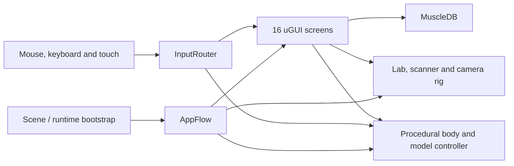

<h1 align="center">MuscleAR</h1>

<p align="center"><strong>Explore the human muscular system in a procedural 3D anatomy lab.</strong></p>

<p align="center">
  <a href="https://unity.com/releases/editor/whats-new/6000.5.5f1"></a>
  
  
  
  <a href="https://github.com/kanishkk-gupta/MuscleAR-Unity"></a>
</p>

## Contents

- [Overview](#overview)
- [Problem statement](#problem-statement)
- [Objectives](#objectives)
- [Features](#features)
- [Screenshots](#screenshots)
- [Architecture and workflow](#architecture-and-workflow)
- [Technology stack](#technology-stack)
- [Project structure](#project-structure)
- [Getting started](#getting-started)
- [Controls](#controls)
- [Implementation details](#implementation-details)
- [Limitations](#limitations)
- [Future improvements](#future-improvements)
- [Contributors](#contributors)
- [License](#license)

## Overview

MuscleAR is a Unity prototype for learning gross muscle anatomy. Its 16-screen flow guides learners from a simulated table scan and model placement to muscle identification, layer views, an elbow-flexion demo, and a five-question quiz. The application builds the lab, body geometry, materials, and interface in C# at runtime. It runs with a virtual background by default and can show a webcam feed when one is available.

## Problem statement

Static diagrams show a fixed viewpoint. A learner studying an unfamiliar muscle must mentally connect its position, attachments, and action across multiple illustrations. MuscleAR puts those views and explanations in one interactive model so the learner can change perspective, inspect a named structure, then recall it in a quiz.

## Objectives

- Generate a layered human model and a lab environment from project source.
- Provide a guided placement and manipulation workflow using mouse, keyboard, or touch input.
- Link selectable anatomy to muscle names, locations, origins, insertions, and actions.
- Demonstrate elbow flexion and provide a short recognition quiz with immediate feedback.

## Features

| Feature | What you can do |
| --- | --- |
| 🧭 Guided placement | Watch a timed scan of the virtual tabletop, then preview and confirm model placement. |
| 🖱️ Model manipulation | Drag to move or rotate depending on the screen. Use scroll, pinch, or keyboard shortcuts for zoom. |
| 💪 Muscle identification | Click or tap selectable regions to highlight a muscle and look up its anatomical information. |
| 🦴 Layer exploration | Switch among Skin, Muscle, Tendon, and Bone views. |
| 🔍 Split-view details | Inspect the whole body and a close-up of the selected muscle in the same screen. |
| 🎚️ Elbow flexion | Use the slider to set a 0–145° flexion angle, or start the automatic animation. |
| 📝 Recognition quiz | Name the highlighted muscle in five questions and review the score. |
| 📷 Optional camera background | Toggle the available webcam or device camera. Placement continues to use the virtual tabletop. |

## Screenshots

| Shot | Capture instructions |
| --- | --- |
| Virtual tabletop scan | Capture screen 04 once **Surface detected** and the table outline are visible. |
| Anatomy layers | Capture screen 11 in Muscle and Bone views at the same camera angle. |
| Muscle detail | Capture screen 12 with a named muscle, showing both camera views and the anatomy card. |
| Quiz | Capture screen 16 after choosing an answer so the highlighted muscle and feedback are both visible. |

The table marks placeholders for project screenshots. Use the virtual background for public captures. Keep raw QA output in the ignored `Shots/` folder and put selected images in a tracked folder such as `docs/images/` when they are ready to publish.

## Architecture and workflow



<details>
<summary>Screen-by-screen guide</summary>

| Screen | Interaction |
| --- | --- |
| 01 · Home | Enter the anatomy lab. |
| 02 · Onboarding | Read the introduction and continue. |
| 03 · Choose mode | Choose AR Explorer, Learn, or Quiz. |
| 04 · Detect surface | Wait for the virtual scan and choose **Place Anatomy**. |
| 05 · Place model | Preview the body, then choose **Place Here**. |
| 06 · Model placed | Review the gestures. Quiz mode goes to screen 16 when you advance. |
| 07 · Move model | Drag the body across the tabletop. |
| 08 · Rotate and zoom | Practice rotation and scaling. |
| 09 · Select a body part | Pick a visible muscle to reveal its name. |
| 10 · Educational toast | Read location, origin, insertion, and function. |
| 11 · Explore layers | Switch among the four body views. |
| 12 · Muscle details | Compare a whole-body view and close-up. |
| 13 · Muscle in action | View or scrub the biceps-focused flexion animation. |
| 14 · Explore another muscle | Start with the deltoid and select other visible muscles. |
| 15 · Learning complete | See session activity and choose **Explore More** or **Take Quiz**. |
| 16 · Quiz | Identify highlighted muscles, check your score, and return to the summary. |

AR Explorer and Learn share the guided route. The Quiz choice branches after placement.

</details>

## Technology stack

| Area | Technology |
| --- | --- |
| Engine and editor | Unity 6.5, editor version `6000.5.5f1` |
| Language | C# |
| Rendering | Built-in Render Pipeline with runtime mesh and material generation |
| UI | Unity UI (uGUI) `2.5.0`, `Canvas`, and `EventSystem` |
| Interaction | Legacy `UnityEngine.Input`, `StandaloneInputModule`, and Unity 3D physics raycasts |
| Camera | Unity `WebCamTexture` |
| Package configuration | Unity Package Manager manifest and lockfile. The manifest includes Multiplayer Center `1.0.1` as an editor dependency. |

## Project structure

```text
MuscleAR-Unity/
├── Assets/
│   ├── Scenes/MuscleAR.unity    # Main scene enabled in build settings
│   ├── Scripts/
│   │   ├── Anatomy/            # Meshes, materials, body state and muscle data
│   │   ├── Core/               # Bootstrap, screen flow and screenshot tour
│   │   ├── Editor/             # Unity Editor setup and capture utilities
│   │   ├── UI/                 # Screens, controls, icons and layout
│   │   └── World/              # Lab, scan, model interaction and camera
│   └── _Recovery/              # Tracked scene snapshot outside the build list
├── Packages/                  # Unity manifest and resolved dependencies
├── ProjectSettings/           # Unity editor version and project configuration
├── .gitignore
└── PROJECT_REPORT.md
```

## Getting started

1. Install Unity Hub and Unity **6000.5.5f1**. [Official editor release](https://unity.com/releases/editor/whats-new/6000.5.5f1)
2. Clone the repository and open the cloned folder from disk in Unity Hub.

   ```bash
   git clone https://github.com/kanishkk-gupta/MuscleAR-Unity.git
   cd MuscleAR-Unity
   ```

3. Let Unity import the project, then open `Assets/Scenes/MuscleAR.unity` from the Project window or use **MuscleAR → Open MuscleAR Scene**.
4. Press **Play** and choose **Enter Anatomy Lab**. For a portrait preview, choose **MuscleAR → Game View → Phone Portrait (390x844)** or select a portrait resolution manually.
5. Follow the on-screen controls through the scan, placement, and learning sequence.

## Controls

| Action | Mouse / keyboard | Touch implementation |
| --- | --- | --- |
| Move in placement and move screens | Left-drag the model view | One-finger drag |
| Rotate while the model accepts gestures | Left-drag horizontally in Explore mode, right-drag, or hold `Q` / `E` | One-finger horizontal drag in Explore mode or two-finger twist |
| Zoom while the model accepts gestures | Scroll, `=` / `+`, or `-` | Pinch |
| Select a muscle | Click a visible muscle in a selection screen | Tap a visible muscle |
| Continue / return | Use on-screen buttons, `→` / `Space` to advance screens, or `←` to go back | On-screen buttons |
| Toggle live camera | `C` or the camera button on screen 04 | Camera button on screen 04 |
| Jump to a screen | `F1` toggles the storyboard sidebar. It also appears in sufficiently wide Game views. | Use the storyboard sidebar if visible. |

Use the on-screen buttons to verify scan gating and answer quiz questions. The global navigation shortcuts advance the storyboard directly.

## Implementation details

- **Startup** · [AppFlow](Assets/Scripts/Core/AppFlow.cs) initializes the world, cameras, model and UI, then activates the home screen. It also provides a fallback bootstrap after a scene loads when no `AppFlow` instance is present.
- **Anatomy** · [HumanBodyBuilder](Assets/Scripts/Anatomy/HumanBodyBuilder.cs) uses swept elliptical meshes and runtime materials. [MuscleDB](Assets/Scripts/Anatomy/MuscleDB.cs) stores 31 muscle or muscle-group records shared by the cards and quiz.
- **Picking** · [ModelController](Assets/Scripts/World/ModelController.cs) casts a ray from the main camera and reads the `MuscleHandle` attached to the first collider hit or its parent hierarchy.
- **Capture** · The `-qatour` command-line option starts a visual walkthrough with captures under `Shots/`. The academic report gives the command and explains what the tour covers. [Academic project report](PROJECT_REPORT.md)

## Limitations

- The scan always targets a fixed virtual table. Device tracking, plane detection, and world anchors are outside the current implementation.
- The anatomy is a stylized teaching model. Clinical accuracy, learning outcomes, camera permission handling, and mobile deployment remain unverified.
- Progress is session-scoped. Only the distinct muscle count is tracked directly. The displayed structure count and progress percentage use formulas.
- Leaving the quiz results via global navigation can leave the **Done** callback attached for the next quiz attempt. Use **Done** to return to the summary.
- The Editor screenshot tour requires an activated Unity installation. Runtime verification was blocked locally by the Unity Editor license check.

## Future improvements

- Integrate AR Foundation with a supported device provider for tracking, real plane selection, and anchors.
- Validate the generated geometry and muscle descriptions with an anatomy instructor.
- Replace illustrative progress figures with completion criteria and optional local persistence.
- Add Play Mode coverage for navigation, gesture bounds, layer changes, and quiz retries.

## Contributors

- **Akshita Jain** is the author of the existing project commit, `7767561`, according to the repository history.

## License

This repository currently has no project license file.
