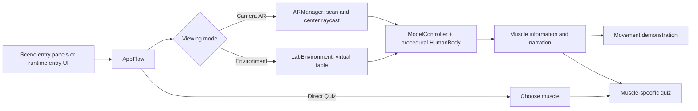

<h1 align="center">MuscleAR</h1>

<p align="center"><strong>Explore six muscles on an interactive 3D model, from a virtual lab to your own tabletop.</strong></p>

<p align="center">
  <a href="https://unity.com/releases/editor/whats-new/6000.5.5f1"></a>
  
  
  
  
  <a href="https://github.com/kanishkk-gupta/MuscleAR-Unity"></a>
</p>

## Contents

- [Overview](#overview)
- [Problem statement](#problem-statement)
- [Objectives](#objectives)
- [Features](#features)
- [Screenshots](#screenshots)
- [Architecture and workflow](#architecture-and-workflow)
- [Technology stack](#technology-stack)
- [Project structure](#project-structure)
- [Getting started](#getting-started)
- [Controls](#controls)
- [Implementation details](#implementation-details)
- [Limitations](#limitations)
- [Future improvements](#future-improvements)
- [Contributors](#contributors)
- [License](#license)

## Overview

MuscleAR is a Unity anatomy learning prototype. Users can select a muscle on a procedural human model, read about its location, origin, insertion and function, listen to a prerecorded explanation, and use a slider to see its action. The same content is available in a virtual environment and through Camera AR on compatible Android devices. Each featured muscle has a five-question quiz.

The [academic project report](PROJECT_REPORT.md) covers the system design, implementation and test evidence.

## Problem statement

Static illustrations give learners fixed views of anatomy. Relating a muscle's position and attachments to a joint movement often requires consulting several figures. MuscleAR brings the model, anatomical notes, movement demonstration and practice questions into the same study flow.

## Objectives

- Let learners place, rotate and scale a 3D anatomy model in either viewing mode.
- Connect each featured muscle to its anatomical description, narration and an interactive movement demonstration.
- Provide immediate answer feedback and a score for each muscle-specific quiz.

## Features

| Feature | What the learner can do |
| --- | --- |
| 📷 **Camera AR** | Scan a real surface on an ARCore-compatible device, aim the center reticle, and place the model. Drag the placement ring to reposition it on a tracked surface. |
| 🧪 **Virtual environment** | Explore the same model in the Editor or in the app's Environment mode. Choose the Lab or Day setting. |
| 🏷️ **Muscle exploration** | Tap a highlighted muscle, use a model callout, or choose a muscle chip to open its information card. |
| 🔊 **Narration** | Hear the selected muscle's recorded explanation and replay it with **Listen Again**. |
| 🎚️ **Movement demonstrations** | Scrub or play a demonstration for each featured muscle. |
| 📝 **Quiz** | Start from the mode menu and choose a muscle, or take a quiz tied to the explored muscle. Review immediate feedback, see the final score and retake the quiz. |

## Screenshots

| Capture | Placeholder |
| --- | --- |
| Virtual environment | **Pending.** Capture the model in the Lab with all six callouts visible. |
| Camera AR | **Pending.** Capture the scan reticle over a tracked tabletop, then the placed model on the same surface. |
| Muscle information and action | **Pending.** Capture one expanded information card and its corresponding action halfway through the slider range. |
| Quiz | **Pending.** Capture the muscle picker, one answered question and the score screen. |

## Architecture and workflow



## Technology stack

| Component | Version or implementation |
| --- | --- |
| Unity Editor | **6000.5.5f1**, Built-in Render Pipeline |
| Project languages and formats | C# scripts, Unity YAML serialization, JSON package manifests |
| Interface | Unity UI (uGUI) **2.5.0** |
| XR | AR Foundation **6.6.2**, Google ARCore XR Plug-in **6.6.2**, XR Plug-in Management **4.7.0** |
| Input | Legacy Unity input for app gestures and uGUI. Input System **1.19.0** is resolved for XR tracked pose input. |
| Android player | ARM64, IL2CPP, minimum Android API level **29** |

The manifest also declares Coplay Unity MCP, Unity AI Assistant, Unity AI Inference and Multiplayer Center. Anatomy content and quizzes run through the project's C# scripts. See the [package manifest](Packages/manifest.json) and [lockfile](Packages/packages-lock.json).

## Project structure

```text
Assets/
  Scenes/MuscleAR.unity   Main scene and serialized entry panels
  Scripts/
    Anatomy/             Procedural meshes, materials, anatomy records and motion
    Core/                AppFlow, audio controller and QA capture tour
    UI/                  Screen classes, widgets and entry UI controller
    World/               Camera, AR, environment, model input and callouts
    Editor/              Build, setup and verification menus
  Editor/                Entry-panel tooling, command-line build and tooltip checks
  Audio/                 Source audio
  Resources/             Runtime audio, interface sprites and material assets
  UI/                    Scene-linked entry artwork and buttons
  XR/                    XR provider and simulation settings
Packages/                Unity manifest and dependency lockfile
ProjectSettings/         Scene list, player settings and pinned Unity version
```

## Getting started

### Run in the Unity Editor

1. Install [Unity 6000.5.5f1](https://unity.com/releases/editor/whats-new/6000.5.5f1) through Unity Hub and install Git so Unity Package Manager can resolve the Git dependency.
2. Clone the project.

   ```bash
   git clone https://github.com/kanishkk-gupta/MuscleAR-Unity.git
   cd MuscleAR-Unity
   ```

3. In Unity Hub, select **Add project from disk** and choose the repository root. Let Unity import the assets and resolve packages.
4. Open [the MuscleAR scene](Assets/Scenes/MuscleAR.unity) and press **Play**. The runtime interface starts in Environment mode in the Editor. Use the on-screen buttons to enter AR Explorer or Quiz.
5. For a portrait preview, use **MuscleAR → Game View → Phone Portrait (390x844)** or set a portrait aspect ratio in Game view.

### Build and run on Android

1. Add **Android Build Support**, **Android SDK & NDK Tools**, and **OpenJDK** for the pinned Editor version. [Unity Android setup](https://docs.unity3d.com/6000.1/Documentation/Manual/android-sdksetup.html)
2. Open **File → Build Profiles**, switch to Android, and verify that `Assets/Scenes/MuscleAR.unity` is enabled. Check that **ARCore** is enabled for Android under **Project Settings → XR Plug-in Management**.
3. Use **Build** to generate an APK in `Builds/`, or use **Build and Run** with a device connected and USB debugging enabled. The custom **MuscleAR → Build Android APK** command writes `Builds/MuscleAR.apk` and attempts to install and launch it through ADB on success.
4. Choose **AR Explorer → Camera AR** as applicable, grant camera access if requested, and scan a well-lit surface. Aim the center of the screen at the detected plane. Tap the scene or **Place Anatomy** when the placement control becomes available. Choose **Environment** for the virtual table. [Google's supported device list](https://developers.google.com/ar/devices)

## Controls

| Action | Touch | Mouse or keyboard in the Game view |
| --- | --- | --- |
| Select muscle | Tap a model muscle, callout or chip | Click the muscle, callout or chip |
| Rotate model | Drag horizontally on the model view | Left-drag horizontally or use **Q / E** |
| Scale model | Pinch in or out | Scroll or use **+ / −** |
| Reposition on a tracked plane | Drag the model's base ring in Camera AR | Left-drag the ring when Camera AR is active and anchored |
| Offset the view in Camera AR | Drag with two fingers | Right-drag while Camera AR is active |
| Play or scrub an action | Tap play or drag the slider | Click play or drag the slider |
| Navigate | Use on-screen buttons or Android Back | **Right / Space** for next, **Left** for back, **Esc** for back handling |

<details>
<summary>Developer shortcuts</summary>

With the runtime Game view focused, **F1** toggles the storyboard panel, **M** switches viewing mode, **L** switches the Environment style, **R** requests reset and rescan, and **C** runs the viewing-mode toggle. Availability depends on the current screen and mode.

</details>

## Implementation details

[AppFlow](Assets/Scripts/Core/AppFlow.cs) wires the two view modes, creates the runtime world and canvas, and routes input and screen transitions. [MainUIController](Assets/Scripts/UI/MainUIController.cs) owns the scene's serialized entry panels. The runtime screen IDs span 1–10 and 13–17.

[HumanBodyBuilder](Assets/Scripts/Anatomy/HumanBodyBuilder.cs) builds anatomy from procedural meshes. [ModelController](Assets/Scripts/World/ModelController.cs) owns placement and manipulation, while [HumanBody](Assets/Scripts/Anatomy/HumanBody.cs) changes highlights and child geometry independently of the placed root. [MuscleDB](Assets/Scripts/Anatomy/MuscleDB.cs) supplies the anatomical text. Narration and effects are loaded from `Resources/Audio`.

<details>
<summary>Six featured muscles and demonstrations</summary>

| Muscle | Demonstrated movement |
| --- | --- |
| Biceps brachii | Elbow flexion |
| Deltoid | Shoulder abduction |
| Pectoralis major | Shoulder movement across the chest |
| Rectus abdominis | Trunk flexion |
| Quadriceps femoris | Knee extension |
| Gastrocnemius | Ankle plantar flexion |

</details>

## Limitations

- The learning flow focuses on six muscles represented by stylized procedural geometry. The model and action angles are illustrative.
- Camera AR targets ARCore-compatible Android devices. The iOS player identifier is configured, and the project has no ARKit provider in the manifest.
- Anatomy layers exist in the model and QA tooling. The current user flow has no dedicated layer-explorer or split-detail screens.
- Quiz results and exploration progress are held in memory for the active session.

## Future improvements

- Expand the learning set and have the anatomical content reviewed by educators.
- Expose layer selection and compare anatomical structures in the learner interface.
- Validate Camera AR on a documented device matrix and evaluate usability and learning with participants.

## Contributors

The available Git history records contributions by **Akshita Jain** and **kanishkk-gupta**.

## License

The project has no repository-wide license file. Contact the rights holders for reuse or redistribution permissions.
